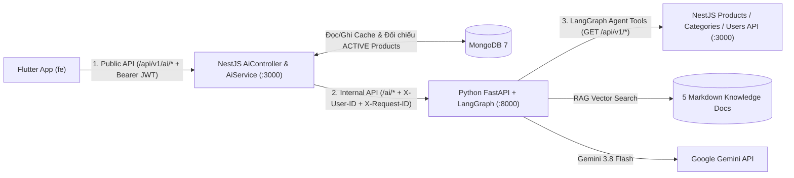

# ReMarket — AI API Contract (Frozen v1.0)

> **Status**: Frozen (Phase 7 — API Contract Freeze)  
> **Source of Truth**:
> - NestJS AI Gateway: [`ai.controller.ts`](file:///d:/cross-ck/apps/backend/src/modules/ai/ai.controller.ts), [`ai.service.ts`](file:///d:/cross-ck/apps/backend/src/modules/ai/ai.service.ts), [`ai-http.client.ts`](file:///d:/cross-ck/apps/backend/src/modules/ai/ai-http.client.ts), [`ai.dto.ts`](file:///d:/cross-ck/apps/backend/src/modules/ai/dto/ai.dto.ts)
> - FastAPI AI Router: [`ai.py`](file:///d:/cross-ck/apps/ai/app/api/routes/ai.py), [`health.py`](file:///d:/cross-ck/apps/ai/app/api/routes/health.py), [`ai_schemas.py`](file:///d:/cross-ck/apps/ai/app/schemas/ai_schemas.py)
> - LangGraph Workflows & Tools: [`listing_graph.py`](file:///d:/cross-ck/apps/ai/app/graphs/listing_graph.py), [`pricing_graph.py`](file:///d:/cross-ck/apps/ai/app/graphs/pricing_graph.py), [`inspection_graph.py`](file:///d:/cross-ck/apps/ai/app/graphs/inspection_graph.py), [`assistant_graph.py`](file:///d:/cross-ck/apps/ai/app/graphs/assistant_graph.py), [`registry.py`](file:///d:/cross-ck/apps/ai/app/tools/registry.py)

---

## 1. Phân Tách 3 Tầng Giao Tiếp AI (3-Tier Architecture)

> [!IMPORTANT]
> **Quy tắc kiến trúc bắt buộc cho Flutter Developer**:
> Ứng dụng Flutter **CHỈ** gọi tầng **Public Gateway API** tại NestJS (`http://localhost:3000/api/v1/ai/*`) kèm `Authorization: Bearer <accessToken>`. Flutter **TUYỆT ĐỐI KHÔNG** gọi trực tiếp sang cổng `:8000` của Python FastAPI.



### Bảng Phân Loại Toàn Bộ Endpoints & Tools

| Tầng | Tên Endpoint / Tool | Phương thức & Đường dẫn | Ai được phép gọi? | Trạng thái tích hợp |
|---|---|---|---|---|
| **Tầng 1: Public Gateway API** *(Dành cho Flutter)* | **AI 1: Listing Generator** | `POST /api/v1/ai/generate-listing` | Flutter (Bearer JWT) | Đã tích hợp hoàn chỉnh |
| **Tầng 1: Public Gateway API** | **AI 2: Price Estimator** | `POST /api/v1/ai/estimate-price` | Flutter (Bearer JWT) | Đã tích hợp hoàn chỉnh |
| **Tầng 1: Public Gateway API** | **AI 3: Buyer Checklist** | `POST /api/v1/ai/buyer-checklist` | Flutter (Bearer JWT) | Đã tích hợp + Cache MongoDB |
| **Tầng 1: Public Gateway API** | **AI 4: Shopping Assistant Chat** | `POST /api/v1/ai/chat` | Flutter (Bearer JWT) | Đã tích hợp + Lọc sản phẩm thật |
| **Tầng 1: Public Gateway API** | **Get AI Chat History** | `GET /api/v1/ai/conversations/:conversationId` | Flutter (Bearer JWT, Owner) | Đã tích hợp + Cô lập quyền sở hữu |
| **Tầng 1: Public Gateway API** | **Delete AI Chat History** | `DELETE /api/v1/ai/conversations/:conversationId` | Flutter (Bearer JWT, Owner) | Đã tích hợp + Cô lập quyền sở hữu |
| **Tầng 2: Internal FastAPI** *(Nội bộ giữa NestJS → Python)* | Internal Listing Graph | `POST http://localhost:8000/ai/generate-listing` | Chỉ `AiHttpClient` (NestJS) | Nội bộ |
| **Tầng 2: Internal FastAPI** | Internal Pricing Graph | `POST http://localhost:8000/ai/estimate-price` | Chỉ `AiHttpClient` (NestJS) | Nội bộ |
| **Tầng 2: Internal FastAPI** | Internal Inspection Graph | `POST http://localhost:8000/ai/buyer-checklist` | Chỉ `AiHttpClient` (NestJS) | Nội bộ |
| **Tầng 2: Internal FastAPI** | Internal Assistant Graph | `POST http://localhost:8000/ai/chat` | Chỉ `AiHttpClient` (NestJS) | Nội bộ |
| **Tầng 2: Internal FastAPI** | Internal Conversation State | `GET/DELETE http://localhost:8000/ai/conversations/{id}` | Chỉ `AiHttpClient` (NestJS) | Nội bộ |
| **Tầng 2: Internal FastAPI** *(Diagnostic / Supervisor)* | Supervisor Router / Diagnostics | `POST /ai/agent/execute`, `POST /ai/test-chat`, `GET /health`, `GET /health/config` | Nội bộ / Kiểm thử | Không mở ra Gateway cho Flutter |
| **Tầng 3: LangGraph Agent Tools** *(Nội bộ Python → NestJS)* | `search_products`, `filter_products`, `get_product_detail`, `get_related_products`, `get_product_categories`, `get_seller_public_profile` | Gọi HTTP `GET http://localhost:3000/api/v1/*` qua `BackendClient` | Chỉ các Node trong LangGraph (`pricing_graph`, `inspection_graph`, `assistant_graph`) | Nội bộ |

---

## 2. Cơ Chế Timeout, Fallback & Bảo Đảm Không Ảo Giác (Anti-Hallucination)

1. **Timeout 2 Lớp**:
   - **Lớp Gemini LLM (`GEMINI_TIMEOUT_SECONDS`)**: Mặc định `25` giây, tối đa `1` lần retry (`GEMINI_MAX_RETRIES=1`).
   - **Lớp NestJS Gateway (`AI_SERVICE_TIMEOUT_MS`)**: Mặc định `30000` ms (`30` giây). Nếu FastAPI phản hồi chậm hơn 30 giây, `AiHttpClient` chủ động hủy kết nối (`AbortController`) và trả về `504 Gateway Timeout` (`error.code = "AI_REQUEST_TIMEOUT"`).
2. **Deterministic Fallback trong LangGraph**:
   - Trong cả 4 đồ thị (`listing_graph`, `pricing_graph`, `inspection_graph`, `assistant_graph`), nếu `GEMINI_API_KEY` bị thiếu, hết quota (`429`), hoặc Gemini timeout, các node LangGraph **không làm sập request** mà tự động chuyển sang bộ khung sinh nội dung có cấu trúc (dựa trên dữ liệu đầu vào thật, công thức khấu hao theo `condition`, và kết quả truy vấn từ Agent Tools + RAG).
3. **Chống Ảo Giác (Zero Hallucination) trong AI Chat & Price Estimator**:
   - Trước khi trả kết quả về cho Flutter, `AiService` trong NestJS trích xuất danh sách ID từ `recommended_products` / `matchedProducts`, truy vấn lại trực tiếp vào MongoDB (`ProductsService.findActiveByIds`) và **chỉ giữ lại các sản phẩm có thật đang ở trạng thái `ACTIVE`**.

---

## 3. Chi Tiết Từng Endpoint AI Dành Cho Flutter (`/api/v1/ai/*`)

Tất cả 6 endpoints dưới đây đều yêu cầu:
- **Authentication**: **Required** (`Authorization: Bearer <accessToken>`)
- **Headers**:
  - `Authorization: Bearer <accessToken>`
  - `Content-Type: application/json`
  - `X-Request-ID: <uuid>` *(Optional — nếu gửi lên, Backend sẽ chuyển tiếp sang FastAPI và trả lại trong header `X-Request-ID`)*

---

### 3.1. AI 1 — Tạo nội dung tin đăng bán (`POST /api/v1/ai/generate-listing`)

- **Mục đích**: Giúp người bán tạo tiêu đề gợi ý, bài mô tả chuẩn 3 phần (`📦 [TỔNG QUAN SẢN PHẨM]`, `🔍 [TÌNH TRẠNG & KHUYẾT ĐIỂM MINH BẠCH]`, `🤝 [LÝ DO BÁN & CAM KẾT GIAO DỊCH]`), danh mục gợi ý, bộ tags, điểm nổi bật và lời khuyên chụp ảnh minh bạch.
- **HTTP Method & URL**: `POST /api/v1/ai/generate-listing`
- **HTTP Status thành công**: `200 OK`

#### Request Body (`GenerateListingDto`)
> Hỗ trợ song song cả tên trường `camelCase` chuẩn của NestJS (`title`, `price`, `defectDisclosure`, `imageUrls`) và các bí danh (`productName`, `sellingPrice`, `defects`, `images`). **Ít nhất một trong hai trường `title` hoặc `productName` phải có mặt**.

| Trường | Kiểu | Bắt buộc | Ràng buộc Validation | Mô tả |
|---|---|---|---|---|
| `title` *(hoặc `productName`)* | `string` | **Có** (1 trong 2) | `2..150` ký tự | Tên sản phẩm hoặc tiêu đề nháp |
| `brand` | `string` | Không | Tối đa `100` ký tự | Thương hiệu / Hãng sản xuất |
| `category` | `string` | Không | Tối đa `100` ký tự | Tên hoặc slug danh mục |
| `condition` | `string` | Không | Tối đa `50` ký tự | `NEW`, `LIKE_NEW`, `GOOD`, hoặc `FAIR` (mặc định `GOOD`) |
| `price` *(hoặc `sellingPrice`)* | `number` | Không | `>= 0` | Giá dự kiến bán (VNĐ) |
| `originalPrice` | `number` | Không | `>= 0` | Giá mua mới ban đầu (VNĐ) |
| `defectDisclosure` *(hoặc `defects`)* | `string` | Không | Tối đa `1000` ký tự | Mô tả vết xước, hao mòn hoặc lỗi thực tế |
| `imageUrls` *(hoặc `images`)* | `string[]` | Không | Tối đa `10` URL, mỗi URL `<= 2048` ký tự | Danh sách URL ảnh sản phẩm đã upload |
| `imageBase64` | `string` | Không | Tối đa `7,000,000` ký tự | Chuỗi ảnh mã hóa Base64 để Gemini phân tích đa phương thức |
| `imageMimeType` | `string` | Không | Tối đa `50` ký tự | Ví dụ: `"image/jpeg"`, `"image/png"`, `"image/webp"` |

#### Ví dụ Request:
```json
{
  "title": "Bàn phím cơ Keychron K6 Wireless RGB",
  "brand": "Keychron",
  "category": "Máy tính & Phụ kiện",
  "condition": "LIKE_NEW",
  "originalPrice": 2450000,
  "price": 1350000,
  "defectDisclosure": "Xước nhẹ 1mm ở cạnh phải khung nhôm, các phím và LED RGB hoạt động 100%, đầy đủ hộp và cáp.",
  "imageUrls": [
    "http://localhost:3000/uploads/products/keychron-k6.jpg"
  ]
}
```

#### Ví dụ Response (`200 OK`):
```json
{
  "success": true,
  "message": "AI listing content generated successfully",
  "data": {
    "suggestedTitle": "Bàn phím cơ Keychron K6 Wireless RGB - Như mới (99%)",
    "suggested_title": "Bàn phím cơ Keychron K6 Wireless RGB - Như mới (99%)",
    "description": "📦 [TỔNG QUAN SẢN PHẨM]\nBàn phím cơ Keychron K6 Wireless RGB chính hãng Keychron (Danh mục: Máy tính & Phụ kiện). Mức giá nhượng lại: 1,350,000 VNĐ (tiết kiệm đáng kể so với giá mua mới 2,450,000 VNĐ).\n\n🔍 [TÌNH TRẠNG & KHUYẾT ĐIỂM MINH BẠCH]\n- Cấp độ tình trạng: Như mới (99%) (LIKE_NEW).\n- Công bố khuyết điểm thực tế: Xước nhẹ 1mm ở cạnh phải khung nhôm, các phím và LED RGB hoạt động 100%, đầy đủ hộp và cáp.\n\n🤝 [LÝ DO BÁN & CAM KẾT GIAO DỊCH]\nDo ít có nhu cầu sử dụng nên mình nhượng lại cho bạn nào cần. Cam kết thông tin và hình ảnh hoàn toàn đúng thực tế, hỗ trợ kiểm tra trực tiếp trước khi nhận hàng.",
    "suggestedCategory": "Máy tính & Phụ kiện",
    "suggested_category": "Máy tính & Phụ kiện",
    "tags": [
      "keychron",
      "máy tính & phụ kiện",
      "secondhand",
      "likenew"
    ],
    "highlights": [
      "Thương hiệu: Keychron",
      "Tình trạng thực tế: Như mới (99%)",
      "Tiết kiệm ~45% so với giá gốc (2,450,000 VNĐ)"
    ],
    "transparencyNote": "Người bán đã công khai chi tiết ngoại hình và tình trạng hoạt động thực tế của sản phẩm.",
    "ConditionTips": [
      "Chụp rõ các góc cạnh và khu vực có vết xước hoặc hao mòn.",
      "Giao dịch trực tiếp hoặc quay video kiểm tra trước khi gửi hàng.",
      "Cung cấp thêm hình ảnh tem/serial hoặc hóa đơn mua hàng nếu còn giữ."
    ],
    "condition_tips": [
      "Chụp rõ các góc cạnh và khu vực có vết xước hoặc hao mòn.",
      "Giao dịch trực tiếp hoặc quay video kiểm tra trước khi gửi hàng.",
      "Cung cấp thêm hình ảnh tem/serial hoặc hóa đơn mua hàng nếu còn giữ."
    ],
    "model": "gemini-3.8-flash"
  },
  "meta": {}
}
```

---

### 3.2. AI 2 — Định giá sản phẩm đồ cũ 3 mức (`POST /api/v1/ai/estimate-price`)

- **Mục đích**: Đề xuất 3 mức giá hợp lý (`quickSellPrice` < `recommendedPrice` < `maxFairPrice`) dựa trên giá gốc, cấp độ tình trạng (`condition`), khuyết điểm, và **các sản phẩm tương đương có thật đang mở bán trên ReMarket** (lấy qua Agent Tools `search_products` / `filter_products`).
- **HTTP Method & URL**: `POST /api/v1/ai/estimate-price`
- **HTTP Status thành công**: `200 OK`

#### Request Body (`EstimatePriceDto`)

| Trường | Kiểu | Bắt buộc | Ràng buộc Validation | Mô tả |
|---|---|---|---|---|
| `title` *(hoặc `productName`)* | `string` | **Có** (1 trong 2) | `2..150` ký tự | Tên sản phẩm cần định giá |
| `condition` | `string` | **Có** | Tối đa `50` ký tự | `NEW`, `LIKE_NEW`, `GOOD`, hoặc `FAIR` |
| `brand` | `string` | Không | Tối đa `100` ký tự | Thương hiệu |
| `category` | `string` | Không | Tối đa `100` ký tự | Danh mục |
| `originalPrice` | `number` | Không | `>= 0` | Giá mua mới ban đầu (VNĐ) |
| `defectDisclosure` *(hoặc `defects`)* | `string` | Không | Tối đa `1000` ký tự | Khuyết điểm hoặc hao mòn thực tế |

#### Ví dụ Request:
```json
{
  "title": "Bàn phím cơ Keychron K6 Wireless",
  "brand": "Keychron",
  "category": "Máy tính & Phụ kiện",
  "condition": "LIKE_NEW",
  "originalPrice": 2450000,
  "defectDisclosure": "Xước dăm nhẹ ở cạnh khung nhôm, đầy đủ cáp và hộp."
}
```

#### Ví dụ Response (`200 OK`):
```json
{
  "success": true,
  "message": "AI price estimation completed successfully",
  "data": {
    "quickSellPrice": 1510000,
    "quick_sell_price": 1510000,
    "recommendedPrice": 1720000,
    "recommended_price": 1720000,
    "maxFairPrice": 1860000,
    "max_fair_price": 1860000,
    "confidence": 0.85,
    "reasoning": "Mức giá đề xuất được tính toán dựa trên giá gốc (2,450,000 VNĐ), hệ số khấu hao tình trạng LIKE_NEW (còn khoảng 72% giá trị), kết hợp đối chiếu với 2 sản phẩm tương đương trên sàn ReMarket.",
    "factors": [
      "Khấu hao theo tình trạng: LIKE_NEW",
      "Tham chiếu giá gốc ban đầu: 2,450,000 VNĐ",
      "Khấu trừ nhẹ do vết xước dăm ở khung nhôm"
    ],
    "comparableProducts": [
      {
        "id": "672b3a9f8e1b2c0012345681",
        "title": "Bàn phím cơ Keychron K6 RGB Gateron Brown Switch",
        "price": 1350000,
        "condition": "LIKE_NEW",
        "status": "ACTIVE"
      }
    ],
    "model": "gemini-3.8-flash"
  },
  "meta": {}
}
```

> **Đảm bảo Bất biến Toán học**: Luôn thỏa mãn `0 <= quickSellPrice <= recommendedPrice <= maxFairPrice`.

---

### 3.3. AI 3 — Tạo Checklist Kiểm Tra Hàng & Câu Hỏi Cho Người Bán (`POST /api/v1/ai/buyer-checklist`)

- **Mục đích**: Khi người mua xem chi tiết một sản phẩm (hoặc nhập thông tin sản phẩm), AI phân tích mô tả & khuyết điểm đã công bố để tạo danh sách các bước kiểm tra thực tế (`checklist`), 3 câu hỏi quan trọng cần hỏi người bán (`questionsForSeller`), và cảnh báo rủi ro (`riskNotes`).
- **Cơ chế Cache trên MongoDB (`Product.aiMetadata`)**:
  1. Nếu gửi `productId` (và `forceRefresh !== true`), `AiService` kiểm tra trường `product.aiMetadata.buyerChecklist` và `product.aiMetadata.questionsForSeller` trong MongoDB.
  2. Nếu đã có sẵn trong DB, NestJS trả về ngay lập tức với `"cached": true` và `"model": "mongodb-cache"` (tốc độ `< 10ms`, không tốn token Gemini).
  3. Nếu chưa có hoặc `forceRefresh: true`, NestJS gọi sang FastAPI `POST /ai/buyer-checklist`, lưu kết quả mới vào `product.aiMetadata` trong MongoDB, và trả về `"cached": false`.

#### Request Body (`BuyerChecklistDto`)
> **Quy tắc bắt buộc**: Phải truyền **`productId`** (hoặc `product_id`) **HOẶC** truyền **`title`** (hoặc `productName`). Nếu thiếu cả hai, Backend trả về `400 VALIDATION_ERROR`. Nếu truyền `productId` nhưng không tìm thấy trong MongoDB, Backend trả về `404 PRODUCT_NOT_FOUND`.

| Trường | Kiểu | Bắt buộc | Ràng buộc Validation | Mô tả |
|---|---|---|---|---|
| `productId` *(hoặc `product_id`)* | `string` | Có (nếu không có `title`) | MongoDB ObjectId hợp lệ | ID sản phẩm đang xem |
| `title` *(hoặc `productName`)* | `string` | Có (nếu không có `productId`) | Tối đa `150` ký tự | Tên sản phẩm (khi tạo checklist ad-hoc không cần `productId`) |
| `brand` | `string` | Không | Tối đa `100` ký tự | Thương hiệu |
| `category` | `string` | Không | Tối đa `100` ký tự | Danh mục |
| `condition` | `string` | Không | Tối đa `50` ký tự | `NEW`, `LIKE_NEW`, `GOOD`, `FAIR` |
| `price` | `number` | Không | `>= 0` | Giá bán (VNĐ) |
| `defectDisclosure` *(hoặc `defects`)* | `string` | Không | Tối đa `1000` ký tự | Khuyết điểm đã công bố |
| `description` | `string` | Không | Tối đa `2000` ký tự | Mô tả chi tiết tin đăng |
| `forceRefresh` | `boolean` | Không | Mặc định `false` | Đặt `true` để bỏ qua cache MongoDB và bắt buộc gọi lại Gemini AI |

#### Ví dụ Request (Theo `productId` trên màn hình Chi tiết Sản phẩm):
```json
{
  "productId": "672b3a9f8e1b2c0012345679",
  "forceRefresh": false
}
```

#### Ví dụ Response (`200 OK`):
```json
{
  "success": true,
  "message": "AI buyer checklist generated successfully",
  "data": {
    "productId": "672b3a9f8e1b2c0012345679",
    "checklist": [
      "Đối chiếu ngoại hình thực tế với hình ảnh tin đăng và kiểm tra kỹ: Đệm tai còn êm, xước nhẹ trên vỏ hộp đựng.",
      "Kiểm tra kết nối Bluetooth, chất lượng âm thanh hai bên tai nghe và tính năng chống ồn chủ động (ANC).",
      "Kiểm tra cổng sạc Type-C, thời lượng pin thực tế và микро đàm thoại.",
      "Xác nhận đầy đủ phụ kiện đi kèm (hộp đựng, cáp sạc, cáp AUX) trước khi thanh toán."
    ],
    "questionsForSeller": [
      "Ngoài vết xước nhẹ trên vỏ hộp đựng đã nêu, tai nghe có phát sinh lỗi kết nối hay chai pin không?",
      "Sản phẩm đã từng qua sửa chữa, bung mở hoặc thay đệm tai chưa?",
      "Bạn có hỗ trợ gặp mặt test trực tiếp hoặc quay video test âm thanh trước khi gửi hàng không?"
    ],
    "suggested_questions": [
      "Ngoài vết xước nhẹ trên vỏ hộp đựng đã nêu, tai nghe có phát sinh lỗi kết nối hay chai pin không?",
      "Sản phẩm đã từng qua sửa chữa, bung mở hoặc thay đệm tai chưa?",
      "Bạn có hỗ trợ gặp mặt test trực tiếp hoặc quay video test âm thanh trước khi gửi hàng không?"
    ],
    "riskNotes": [
      "Kiểm tra kỹ khu vực khuyết điểm đã công bố trước khi thanh toán.",
      "Không chuyển khoản đặt cọc trước khi xác minh thực tế sản phẩm."
    ],
    "risk_notes": [
      "Kiểm tra kỹ khu vực khuyết điểm đã công bố trước khi thanh toán.",
      "Không chuyển khoản đặt cọc trước khi xác minh thực tế sản phẩm."
    ],
    "inspectionSummary": "Đánh giá kiểm tra cho Tai nghe Sony WH-1000XM4 (Tình trạng: LIKE_NEW).",
    "cached": false,
    "model": "gemini-3.8-flash"
  },
  "meta": {}
}
```

---

### 3.4. AI 4 — Trợ lý Mua sắm Đa lượt (Multi-turn AI Shopping Assistant) (`POST /api/v1/ai/chat`)

- **Mục đích**: Trò chuyện nhiều lượt (multi-turn conversation) với người mua để tư vấn sản phẩm, tìm kiếm/lọc sản phẩm thật trong kho ReMarket theo ngân sách & nhu cầu, giải đáp chính sách giao dịch an toàn (qua RAG), và gợi ý câu hỏi tiếp theo.
- **Cơ chế Nhớ Ngữ Cảnh (`thread_id`) & Cô lập Quyền sở hữu**:
  - Lượt đầu tiên: Flutter có thể để trống `thread_id` (hoặc tự sinh UUID). Backend sẽ tự tạo `thread_id` dạng `user-<userId>-<timestamp>` và trả về trong response.
  - Các lượt tiếp theo: Flutter gửi lại `thread_id` nhận được ở lượt trước để LangGraph Checkpointer khôi phục toàn bộ lịch sử hội thoại, ngân sách (`maxBudget`), danh mục ưa thích, và danh sách sản phẩm vừa gợi ý.
  - **Bảo mật (`403 FORBIDDEN`)**: Mỗi `thread_id` được gắn cứng với `user_id` của người tạo trong LangGraph Checkpointer. Nếu User B cố tình gửi `thread_id` của User A, hệ thống lập tức chặn và trả về `403 FORBIDDEN`.

#### Request Body (`AiChatDto`)

| Trường | Kiểu | Bắt buộc | Ràng buộc Validation | Mô tả |
|---|---|---|---|---|
| `message` | `string` | **Có** | `1..2000` ký tự | Câu hỏi hoặc yêu cầu của người dùng |
| `thread_id` *(hoặc `conversation_id`)* | `string` | Không | Tối đa `128` ký tự | Mã phiên hội thoại đa lượt |
| `previousInteractionId` | `string` | Không | Tối đa `128` ký tự | Bí danh tương thích ngược cho `thread_id` |
| `maxBudget` | `number` | Không | `>= 0` | Ngân sách tối đa (VNĐ) nếu muốn truyền tường minh |
| `category` | `string` | Không | Tối đa `100` ký tự | Danh mục ưu tiên |

#### Ví dụ Request (Lượt 1 & Lượt 2):
```json
{
  "message": "Mình cần tìm bàn phím cơ hoặc phụ kiện máy tính dưới 2 triệu để học lập trình",
  "thread_id": "conv-student-001",
  "maxBudget": 2000000
}
```

#### Ví dụ Response (`200 OK`):
```json
{
  "success": true,
  "message": "AI shopping assistant response generated successfully",
  "data": {
    "reply": "Chào bạn! Với ngân sách dưới 2,000,000 VNĐ để học lập trình, mình tìm thấy mẫu **Bàn phím cơ Keychron K6 RGB Gateron Brown Switch** đang mở bán trên ReMarket với giá **1,350,000 VNĐ** (tình trạng Như mới 99%). Bạn có muốn xem chi tiết hoặc nhận checklist kiểm tra mẫu bàn phím này không?",
    "response": "Chào bạn! Với ngân sách dưới 2,000,000 VNĐ để học lập trình, mình tìm thấy mẫu **Bàn phím cơ Keychron K6 RGB Gateron Brown Switch** đang mở bán trên ReMarket với giá **1,350,000 VNĐ** (tình trạng Như mới 99%). Bạn có muốn xem chi tiết hoặc nhận checklist kiểm tra mẫu bàn phím này không?",
    "thread_id": "conv-student-001",
    "conversation_id": "conv-student-001",
    "interactionId": "conv-student-001",
    "tools_used": [
      "search_products",
      "filter_products"
    ],
    "matchedProducts": [
      {
        "_id": "672b3a9f8e1b2c0012345681",
        "id": "672b3a9f8e1b2c0012345681",
        "title": "Bàn phím cơ Keychron K6 RGB Gateron Brown Switch",
        "description": "Bàn phím cơ không dây 65% nhỏ gọn...",
        "price": 1350000,
        "originalPrice": 2450000,
        "condition": "LIKE_NEW",
        "status": "ACTIVE",
        "images": [
          "https://images.unsplash.com/photo-1587829741301-dc798b83add3"
        ],
        "sellerId": {
          "_id": "672b3a9f8e1b2c0012345678",
          "id": "672b3a9f8e1b2c0012345678",
          "displayName": "Nguyễn Văn An",
          "avatarUrl": null,
          "location": "Thủ Đức, TP.HCM",
          "isEmailVerified": true,
          "status": "ACTIVE"
        },
        "categoryId": {
          "_id": "672b3a9f8e1b2c0012345670",
          "id": "672b3a9f8e1b2c0012345670",
          "name": "Máy tính & Phụ kiện",
          "slug": "computers-accessories",
          "icon": "laptop_mac"
        }
      }
    ],
    "recommended_products": [
      {
        "id": "672b3a9f8e1b2c0012345681",
        "title": "Bàn phím cơ Keychron K6 RGB Gateron Brown Switch",
        "price": 1350000,
        "condition": "LIKE_NEW",
        "status": "ACTIVE",
        "category": "Máy tính & Phụ kiện",
        "images": [
          "https://images.unsplash.com/photo-1587829741301-dc798b83add3"
        ],
        "defectDisclosure": "Xước nhẹ 1mm ở cạnh phải khung nhôm"
      }
    ],
    "follow_up_questions": [
      "Gợi ý checklist kiểm tra cho sản phẩm này",
      "So sánh giá các sản phẩm trên",
      "Lọc thêm các sản phẩm tình trạng LIKE_NEW"
    ],
    "model": "gemini-3.8-flash"
  },
  "meta": {}
}
```

> **Gợi ý cho Flutter Developer**:
> - Hiển thị nội dung tin nhắn AI từ `data.reply`.
> - Hiển thị thẻ sản phẩm (Product Cards) trực tiếp từ `data.matchedProducts` (đã có đầy đủ `_id`, `title`, `price`, `condition`, `images`, `sellerId`, `categoryId` giống hệt `GET /api/v1/products`).
> - Hiển thị các nút gợi ý bấm nhanh (Quick Reply Chips) từ `data.follow_up_questions`.

---

### 3.5. Xem Lịch sử Hội thoại AI (`GET /api/v1/ai/conversations/:conversationId`)

- **HTTP Method & URL**: `GET /api/v1/ai/conversations/:conversationId`
- **Authentication**: Required (`Authorization: Bearer <accessToken>`, phải là chủ sở hữu của `conversationId`).
- **Response (`200 OK`)**:
  ```json
  {
    "success": true,
    "message": "AI conversation history retrieved successfully",
    "data": {
      "conversation_id": "conv-student-001",
      "thread_id": "conv-student-001",
      "exists": true,
      "turn_count": 2,
      "messages": [
        {
          "role": "user",
          "content": "Mình cần tìm bàn phím cơ dưới 2 triệu"
        },
        {
          "role": "assistant",
          "content": "Chào bạn! Với ngân sách dưới 2,000,000 VNĐ..."
        }
      ],
      "user_preferences": {
        "max_budget": 2000000,
        "category": "Máy tính & Phụ kiện"
      },
      "last_recommended_product_ids": [
        "672b3a9f8e1b2c0012345681"
      ]
    },
    "meta": {}
  }
  ```

---

### 3.6. Xóa Lịch sử Hội thoại AI (`DELETE /api/v1/ai/conversations/:conversationId`)

- **HTTP Method & URL**: `DELETE /api/v1/ai/conversations/:conversationId`
- **Authentication**: Required (`Authorization: Bearer <accessToken>`, phải là chủ sở hữu của `conversationId`).
- **Response (`200 OK`)**:
  ```json
  {
    "success": true,
    "message": "AI conversation deleted successfully",
    "data": {
      "conversation_id": "conv-student-001",
      "thread_id": "conv-student-001",
      "deleted": true
    },
    "meta": {}
  }
  ```

---

## 4. Đặc Tả 6 Internal LangGraph Agent Tools (`apps/ai/app/tools/`)

Các công cụ này chỉ được thực thi bên trong Python AI Service (`Pricing Graph`, `Inspection Graph`, `Shopping Assistant Graph`) thông qua `BackendClient` gọi tới NestJS Backend (`BACKEND_API_URL=http://localhost:3000/api/v1`):

| Tên Tool (`@tool`) | File định nghĩa | Endpoint NestJS được gọi | Chức năng & Quy tắc Bảo mật |
|---|---|---|---|
| `search_products` | [`product_tools.py`](file:///d:/cross-ck/apps/ai/app/tools/product_tools.py) | `GET /api/v1/products?search=...&page=...&limit=...` | Tìm kiếm sản phẩm đang mở bán theo từ khóa, hỗ trợ phân trang. |
| `filter_products` | [`product_tools.py`](file:///d:/cross-ck/apps/ai/app/tools/product_tools.py) | `GET /api/v1/products?categoryId=...&minPrice=...&maxPrice=...&condition=...&status=...` | Lọc sản phẩm theo danh mục (tự động ánh xạ tên/slug sang `ObjectId`), khoảng giá, tình trạng (`NEW`, `LIKE_NEW`, `GOOD`, `FAIR`). |
| `get_product_detail` | [`product_tools.py`](file:///d:/cross-ck/apps/ai/app/tools/product_tools.py) | `GET /api/v1/products/:id` | Lấy thông tin chi tiết sản phẩm, khuyết điểm (`defectDisclosure`), giá gốc, danh sách ảnh và thông tin người bán. |
| `get_related_products` | [`product_tools.py`](file:///d:/cross-ck/apps/ai/app/tools/product_tools.py) | `GET /api/v1/products/:id` + `GET /api/v1/products?categoryId=...` | Tìm các sản phẩm tương tự cùng danh mục để so sánh giá hoặc gợi ý thay thế. |
| `get_product_categories` | [`category_tools.py`](file:///d:/cross-ck/apps/ai/app/tools/category_tools.py) | `GET /api/v1/categories` | Lấy danh sách toàn bộ danh mục sản phẩm hợp lệ trên sàn ReMarket. |
| `get_seller_public_profile` | [`user_tools.py`](file:///d:/cross-ck/apps/ai/app/tools/user_tools.py) | `GET /api/v1/users/:id` | Lấy hồ sơ công khai của người bán (`displayName`, `location`, `stats`). **Tuyệt đối lọc bỏ** mọi trường nhạy cảm (`email`, `phone`, `passwordHash`, `refreshTokenHash`, `wishlist`). |
