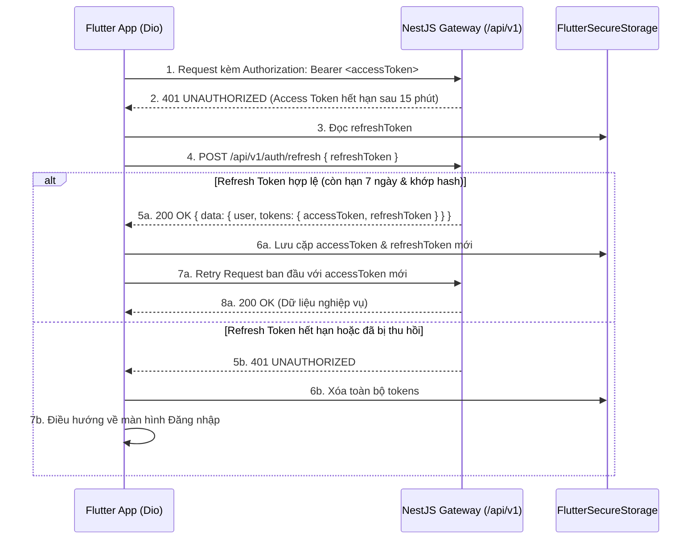

# ReMarket — Authentication & Authorization Contract (Frozen v1.0)

> **Status**: Frozen (Phase 7 — API Contract Freeze)  
> **Source of Truth**:
> - [`auth.controller.ts`](file:///d:/cross-ck/apps/backend/src/modules/auth/auth.controller.ts)
> - [`auth.service.ts`](file:///d:/cross-ck/apps/backend/src/modules/auth/auth.service.ts)
> - [`jwt.strategy.ts`](file:///d:/cross-ck/apps/backend/src/modules/auth/strategies/jwt.strategy.ts)
> - [`optional-jwt-auth.guard.ts`](file:///d:/cross-ck/apps/backend/src/modules/auth/guards/optional-jwt-auth.guard.ts)

---

## 1. Tổng quan Cơ chế Xác thực

ReMarket sử dụng cơ chế **Dual-Token JWT (Access Token + Refresh Token Rotation)**:

| Loại Token | Biến môi trường | Thời hạn mặc định | Mục đích sử dụng | Lưu trữ phía Server |
|---|---|---|---|---|
| **Access Token** | `JWT_SECRET` / `JWT_EXPIRES_IN` | `15m` (15 phút) | Gửi kèm trong header `Authorization: Bearer <accessToken>` cho các API cần xác thực | Stateless (xác thực chữ ký + kiểm tra trạng thái user `ACTIVE` trong MongoDB) |
| **Refresh Token** | `JWT_REFRESH_SECRET` / `JWT_REFRESH_EXPIRES_IN` | `7d` (7 ngày) | Dùng để cấp cặp token mới tại `POST /api/v1/auth/refresh` khi Access Token hết hạn | Lưu dưới dạng **bcrypt hash** (`refreshTokenHash`) trong bảng `users` |

### Cấu trúc JWT Payload
Khi giải mã JWT (`accessToken` hoặc `refreshToken`), payload có cấu trúc:
```json
{
  "sub": "672b3a9f8e1b2c0012345678",
  "email": "nguyen.an@student.edu.vn",
  "role": "user",
  "iat": 1730900000,
  "exp": 1730900900
}
```
Khi đi qua `JwtStrategy.validate()`, NestJS gắn đối tượng `req.user` (`AuthenticatedUser`) gồm:
```json
{
  "userId": "672b3a9f8e1b2c0012345678",
  "email": "nguyen.an@student.edu.vn",
  "role": "user"
}
```

---

## 2. Cách truyền Token trong Header (Flutter Client)

Mọi request tới endpoint có đánh dấu **Authentication: Required** hoặc **Authentication: Optional** (khi người dùng đã đăng nhập) phải truyền header:

```http
Authorization: Bearer <accessToken>
Content-Type: application/json
Accept: application/json
```

> **Lưu ý cho Flutter**:
> - Với các endpoint upload ảnh (`POST /api/v1/upload/images`, `POST /api/v1/products/:id/images`, `POST /api/v1/reports` kèm file), sử dụng `Content-Type: multipart/form-data` cùng với `Authorization: Bearer <accessToken>`.
> - Với endpoint `GET /api/v1/products/:id` (sử dụng `OptionalJwtAuthGuard`), nếu người dùng đã đăng nhập, **luôn gửi kèm** `Authorization: Bearer <accessToken>` để người bán có thể xem được sản phẩm của chính mình khi đang ở trạng thái `DRAFT` hoặc `ARCHIVED`.

---

## 3. Chi tiết các Luồng Xác thực (Auth Flows)

### 3.1. Luồng Đăng ký (`POST /api/v1/auth/register`)

- **Rate Limit**: Tối đa `10` requests / `60` giây trên mỗi IP (`@Throttle({ default: { limit: 10, ttl: 60000 } })`).
- **Quy tắc Validation (`RegisterDto`)**:
  - `email`: Email hợp lệ (`@IsEmail()`), tự động `trim()` và `toLowerCase()`.
  - `password`: Chuỗi từ `8` đến `72` ký tự, bắt buộc có **ít nhất 1 chữ cái và 1 chữ số** (`/^(?=.*[A-Za-z])(?=.*\d).{8,72}$/`).
  - `displayName`: Chuỗi từ `2` đến `60` ký tự (`@MinLength(2)`, `@MaxLength(60)`).
  - `phone` *(optional)*: Số điện thoại hợp lệ (`@Matches(/^[0-9+\-\s()]{8,20}$/)`).
  - `location` *(optional)*: Tối đa `120` ký tự.
- **Xử lý phía Server**:
  1. Kiểm tra trùng `email` (nếu đã tồn tại -> trả về `409 Conflict`).
  2. Hash mật khẩu bằng `bcrypt` (12 salt rounds).
  3. Tạo tài khoản với `role: "user"`, `status: "ACTIVE"`.
  4. Cấp cặp `tokens: { accessToken, refreshToken }`, lưu `bcrypt.hash(refreshToken)` vào `user.refreshTokenHash`.
  5. Trả về HTTP `201 Created` kèm `user` và `tokens` ngay lập tức (người dùng không cần gọi thêm `/auth/login`).

#### Ví dụ Request:
```json
{
  "email": "nguyen.an@student.edu.vn",
  "password": "Password123",
  "displayName": "Nguyễn Văn An",
  "phone": "0901234567",
  "location": "Khu đô thị ĐHQG TP.HCM, Thủ Đức"
}
```

#### Ví dụ Response (`201 Created`):
```json
{
  "success": true,
  "message": "Success",
  "data": {
    "user": {
      "_id": "672b3a9f8e1b2c0012345678",
      "id": "672b3a9f8e1b2c0012345678",
      "email": "nguyen.an@student.edu.vn",
      "displayName": "Nguyễn Văn An",
      "phone": "0901234567",
      "avatarUrl": null,
      "bio": null,
      "location": "Khu đô thị ĐHQG TP.HCM, Thủ Đức",
      "role": "user",
      "isEmailVerified": false,
      "status": "ACTIVE",
      "wishlist": [],
      "createdAt": "2026-11-06T15:00:00.000Z",
      "updatedAt": "2026-11-06T15:00:00.000Z"
    },
    "tokens": {
      "accessToken": "eyJhbGciOiJIUzI1NiIsInR5cCI6IkpXVCJ9...",
      "refreshToken": "eyJhbGciOiJIUzI1NiIsInR5cCI6IkpXVCJ9..."
    }
  },
  "meta": {}
}
```

---

### 3.2. Luồng Đăng nhập (`POST /api/v1/auth/login`)

- **HTTP Status khi thành công**: `200 OK`
- **Rate Limit**: Tối đa `10` requests / `60` giây.
- **Quy tắc Validation (`LoginDto`)**:
  - `email`: Email hợp lệ (`@IsEmail()`), tự động `trim()` và `toLowerCase()`.
  - `password`: Chuỗi không rỗng (`@IsString()`, `@MinLength(1)`).
- **Xử lý phía Server**:
  1. Tìm user theo `email`. Nếu không tồn tại -> `401 Unauthorized` (`"Invalid email or password"`).
  2. Kiểm tra `user.status === "ACTIVE"`. Nếu tài khoản bị khóa/suspended -> `403 Forbidden` (`"Account has been suspended"`).
  3. Đối chiếu `bcrypt.compare(password, user.passwordHash)`. Nếu sai -> `401 Unauthorized` (`"Invalid email or password"`).
  4. Ký cặp `tokens` mới, cập nhật `refreshTokenHash` trong DB, trả về `200 OK` với cùng cấu trúc `data: { user, tokens }` như đăng ký.

---

### 3.3. Luồng Làm mới Token (`POST /api/v1/auth/refresh`) — Refresh Token Rotation

- **HTTP Status khi thành công**: `200 OK`
- **Authentication**: Public (không dùng `Authorization` header; truyền `refreshToken` trong body).
- **Rate Limit**: Tối đa `20` requests / `60` giây.
- **Request Body (`RefreshTokenDto`)**:
  ```json
  {
    "refreshToken": "eyJhbGciOiJIUzI1NiIsInR5cCI6IkpXVCJ9..."
  }
  ```
- **Xử lý phía Server (Token Rotation)**:
  1. Verify chữ ký và hạn của `refreshToken` bằng `JWT_REFRESH_SECRET`. Nếu hết hạn hoặc sai chữ ký -> `401 Unauthorized` (`"Invalid or expired refresh token"`).
  2. Tìm user theo `payload.sub`, kiểm tra `user.refreshTokenHash` có tồn tại không (nếu user đã logout, `refreshTokenHash` là `null` -> `401 Unauthorized` `"Refresh token is no longer valid"`).
  3. Kiểm tra `user.status === "ACTIVE"` (nếu bị khóa -> `403 Forbidden` `"Account has been suspended"`).
  4. So khớp `bcrypt.compare(refreshToken, user.refreshTokenHash)`. Nếu không khớp (ví dụ dùng lại refresh token cũ đã bị rotate) -> `401 Unauthorized` (`"Invalid refresh token"`).
  5. Cấp **cặp `accessToken` và `refreshToken` mới**, ghi đè `refreshTokenHash` mới vào DB. Refresh token cũ lập tức hết hiệu lực.

---

### 3.4. Luồng Đăng xuất (`POST /api/v1/auth/logout`)

- **HTTP Status khi thành công**: `200 OK`
- **Authentication**: Required (`Authorization: Bearer <accessToken>`).
- **Request Body**: Không cần body (`{}`).
- **Xử lý phía Server**:
  - Xóa `refreshTokenHash` trong MongoDB (`$set: { refreshTokenHash: null }`).
  - Mọi nỗ lực gọi `/api/v1/auth/refresh` sau đó bằng refresh token cũ sẽ bị từ chối (`401 Unauthorized`).
- **Response (`200 OK`)**:
  ```json
  {
    "success": true,
    "message": "Logged out successfully",
    "data": {
      "message": "Logged out successfully"
    },
    "meta": {}
  }
  ```

---

## 4. Phân biệt rõ các Tình huống `401 Unauthorized` vs `403 Forbidden`

| HTTP Status | Error Code | Nguyên nhân chính xác từ Source Code | Hành động khuyến nghị trên Flutter |
|---|---|---|---|
| `401` | `UNAUTHORIZED` | 1. Thiếu header `Authorization: Bearer <token>`.<br>2. `accessToken` hết hạn (`exp`) hoặc chữ ký không hợp lệ.<br>3. Sai email/mật khẩu khi gọi `/auth/login`.<br>4. `refreshToken` hết hạn, bị thu hồi (sau logout), hoặc đã được rotate.<br>5. User trong JWT không còn tồn tại hoặc không `ACTIVE` khi đi qua `JwtStrategy.validate()`. | - Nếu lỗi xảy ra ở API nghiệp vụ: Interceptor tự động gọi `POST /api/v1/auth/refresh`.<br>- Nếu `/auth/refresh` cũng trả về `401`: Xóa token khỏi `FlutterSecureStorage` và điều hướng về màn hình Login. |
| `403` | `FORBIDDEN` | 1. Tài khoản có `status !== "ACTIVE"` (`SUSPENDED` / `DELETED`) khi đăng nhập hoặc refresh.<br>2. Gọi `PATCH`/`PUT`/`DELETE /products/:id`, `PATCH /products/:id/status`, `POST /products/:id/images` trên sản phẩm **không thuộc quyền sở hữu** (`product.sellerId !== user.userId`).<br>3. Xem chi tiết sản phẩm `GET /products/:id` đang ở trạng thái `DRAFT` hoặc `ARCHIVED` mà người gọi không phải chủ sở hữu.<br>4. Xem hoặc gửi tin nhắn trong cuộc hội thoại (`GET/POST /messages/conversations/:id*`, `PATCH /messages/:id/read`) mà người gọi không phải `buyerId` hoặc `sellerId`.<br>5. Truy cập hoặc xóa lịch sử AI Chat (`POST /ai/chat`, `GET/DELETE /ai/conversations/:id`) với `thread_id` đã thuộc về một `userId` khác. | - **Không gọi** `/auth/refresh` (vì token vẫn hợp lệ, chỉ không đủ quyền).<br>- Hiển thị thông báo lỗi quyền truy cập (`error.details[0]` hoặc `message`) cho người dùng. |

---

## 5. Sơ đồ Luồng Refresh Token Tự động cho Dio Interceptor (Flutter)


