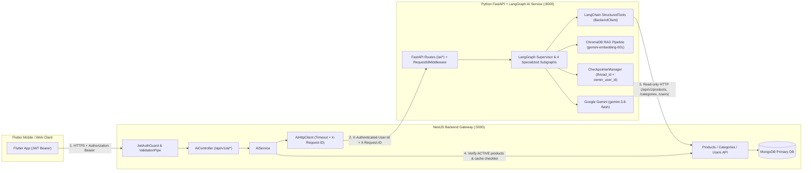

# ReMarket — NestJS Backend & LangGraph AI Service Integration Guide

This document describes the production architecture, authentication boundary, request/response contracts, standardized error codes, and local development instructions for integrating the **NestJS Backend** (`apps/backend`) with the **Python FastAPI + LangGraph AI Service** (`apps/ai`).

---

## 1. Architecture Diagram



### Security & Architectural Invariants
1. **No Direct Client-to-AI Access**: Flutter clients call only NestJS (`/api/v1/ai/*`). `GEMINI_API_KEY` resides exclusively in `apps/ai/.env`.
2. **Verified User Identity**: NestJS `JwtAuthGuard` authenticates the JWT token and injects `X-Authenticated-User-Id` (`req.user.userId`) into requests to Python AI. Client-supplied `user_id` or `userId` in request bodies is rejected with `400 VALIDATION_ERROR`.
3. **Single Source of Truth**: MongoDB is queried exclusively through NestJS services and REST endpoints. Python AI Service never connects directly to MongoDB for business data.
4. **Active Product Verification**: Every product card returned by Shopping Assistant (`POST /api/v1/ai/chat`) is verified against MongoDB (`status: ACTIVE`) with all 10 required fields (`_id`, `sellerId`, `categoryId`, `title`, `description`, `price`, `condition`, `images`, `location`, `status`). Deleted, `SOLD`, `DRAFT`, or `ARCHIVED` listings are never returned.

---

## 2. Environment Configuration

### NestJS Backend (`apps/backend/.env`)
```env
PORT=5000
API_PREFIX=api/v1
MONGODB_URI=mongodb://127.0.0.1:27017/remarket
AI_SERVICE_URL=http://localhost:8000
AI_SERVICE_TOKEN=change-this-optional-internal-service-token
AI_REQUEST_TIMEOUT_MS=15000
```

### Python AI Service (`apps/ai/.env`)
```env
AI_SERVICE_PORT=8000
GEMINI_API_KEY=your_gemini_api_key_here
GEMINI_MODEL=gemini-3.8-flash
GEMINI_EMBEDDING_MODEL=gemini-embedding-001
BACKEND_API_BASE_URL=http://localhost:5000/api/v1
BACKEND_SERVICE_TOKEN=change-this-optional-internal-service-token
VECTOR_STORE_TYPE=chroma
```

---

## 3. API Gateway Endpoints (`/api/v1/ai`)

All endpoints require `Authorization: Bearer <accessToken>`.

### 3.1 `POST /api/v1/ai/generate-listing` (Agent 1 — Listing Generator)

**Request:**
```json
{
  "title": "Bàn phím cơ không dây Gateron Brown Switch",
  "brand": "Keychron",
  "category": "Máy tính & Phụ kiện",
  "condition": "GOOD",
  "defectDisclosure": "Trầy nhẹ góc phải khung nhôm và mất đầu thu USB 2.4GHz",
  "originalPrice": 1800000,
  "price": 950000,
  "images": [
    "https://cdn.remarket.vn/kb-1.jpg",
    "https://cdn.remarket.vn/kb-2.jpg"
  ]
}
```

**Response (`200 OK`):**
```json
{
  "success": true,
  "statusCode": 200,
  "message": "Success",
  "data": {
    "suggestedTitle": "[Pass Nhanh] Keychron Bàn phím cơ không dây Gateron Brown Switch - Tốt (90%)",
    "suggestedDescription": {
      "overview": "Sản phẩm Bàn phím cơ không dây Gateron Brown Switch (Thương hiệu: Keychron) thuộc danh mục Máy tính & Phụ kiện.",
      "condition": "Tình trạng GOOD (Tốt 90%).",
      "defects": "Trầy nhẹ góc phải khung nhôm và mất đầu thu USB 2.4GHz"
    },
    "suggestedDescriptionText": "Tổng quan: ...\nTình trạng: ...\nKhuyết điểm khai báo: ...",
    "suggestedCategory": "Máy tính & Phụ kiện",
    "suggestedTags": ["keychron", "maytinhphukien", "good", "remarket"],
    "transparencyNote": "Người bán đã khai báo minh bạch khuyết điểm: Trầy nhẹ góc phải khung nhôm và mất đầu thu USB 2.4GHz.",
    "transparencyScore": 95,
    "needsMoreInfo": false,
    "clarificationQuestions": [],
    "requiresSellerApproval": true,
    "aiProvider": "gemini-3.8-flash",
    "requestId": "req-9a8b7c6d5e4f3a2b"
  }
}
```

---

### 3.2 `POST /api/v1/ai/estimate-price` (Agent 2 — Smart Price Estimator)

**Request:**
```json
{
  "title": "Laptop Lenovo ThinkPad T14",
  "brand": "Lenovo",
  "category": "Máy tính & Phụ kiện",
  "condition": "GOOD",
  "defectDisclosure": "Trầy nhẹ nắp lưng, pin 85%",
  "originalPrice": 18000000
}
```

**Response (`200 OK`):**
```json
{
  "success": true,
  "statusCode": 200,
  "message": "Success",
  "data": {
    "quickSellPrice": 7900000,
    "recommendedPrice": 9000000,
    "maxFairPrice": 10100000,
    "currency": "VND",
    "confidence": "HIGH",
    "comparableCount": 2,
    "factors": [
      "Tình trạng sản phẩm: GOOD (hệ số giữ giá ~60%)",
      "Khuyết điểm đã khai báo: Trầy nhẹ nắp lưng, pin 85%",
      "Giá mua mới tham chiếu: 18,000,000 VND",
      "Đối chiếu 2 tin đăng thực tế trên hệ thống ReMarket"
    ],
    "dataSourceNote": "Định giá dựa trên 2 sản phẩm tương đồng từ cơ sở dữ liệu Backend ReMarket kết hợp phân tích khấu hao tình trạng.",
    "warnings": [],
    "depreciationPercent": 50,
    "marketDemand": "HIGH",
    "reasoning": "Định giá dựa trên 2 sản phẩm tương đồng...",
    "requiresSellerDecision": true,
    "aiProvider": "gemini-3.8-flash",
    "requestId": "req-1a2b3c4d5e6f7a8b"
  }
}
```

---

### 3.3 `POST /api/v1/ai/buyer-checklist` (Agent 3 — Buyer Inspection Checklist)

**Request:**
```json
{
  "productId": "65f000000000000000000102",
  "forceRefresh": false
}
```

**Response (`200 OK`):**
```json
{
  "success": true,
  "statusCode": 200,
  "message": "Success",
  "data": {
    "productId": "65f000000000000000000102",
    "inspectionPoints": [
      {
        "title": "Xác minh thực tế khuyết điểm và ngoại hình đã khai báo",
        "description": "Kiểm tra kỹ vị trí khuyết điểm người bán đã khai báo (Trầy nhẹ góc nắp lưng, pin còn 91%) xem có ảnh hưởng đến chức năng cốt lõi hay không.",
        "importance": "HIGH"
      },
      {
        "title": "Kiểm tra màn hình, cảm ứng và các cổng kết nối phần cứng",
        "description": "Mở nền trắng/đen kiểm tra điểm chết, ám màn, độ nhạy phím bấm, cắm thử sạc, Wi-Fi, Bluetooth, loa, mic và camera.",
        "importance": "HIGH"
      },
      {
        "title": "Kiểm tra tài khoản bảo mật (iCloud / Google / MDM) và IMEI/Serial",
        "description": "Đảm bảo thiết bị đã đăng xuất hoàn toàn tài khoản ẩn và trùng khớp số Serial/IMEI.",
        "importance": "HIGH"
      }
    ],
    "suggestedQuestions": [
      "Ngoài khuyết điểm đã nêu (Trầy nhẹ góc nắp lưng, pin còn 91%), sản phẩm còn lỗi phát sinh nào khác hoặc đã từng sửa chữa chưa?",
      "Bạn có thể quay video cận cảnh sản phẩm đang hoạt động thực tế dưới ánh sáng rõ trước khi hẹn gặp được không?",
      "Sản phẩm còn đầy đủ phụ kiện đi kèm không và mình có thể kiểm tra trực tiếp tại địa điểm công cộng trước khi thanh toán chứ?"
    ],
    "safetyTips": [
      "Luôn kiểm tra trực tiếp sản phẩm ở nơi công cộng, đủ ánh sáng và chỉ thanh toán sau khi đã test xong mọi chức năng."
    ],
    "safetyTip": "Luôn kiểm tra trực tiếp sản phẩm ở nơi công cộng, đủ ánh sáng và chỉ thanh toán sau khi đã test xong mọi chức năng.",
    "advisoryOnly": true,
    "generatedAt": "2026-11-06T13:00:00.000Z",
    "cached": false,
    "aiProvider": "gemini-3.8-flash",
    "requestId": "req-3c4d5e6f7a8b9c0d"
  }
}
```

---

### 3.4 `POST /api/v1/ai/chat` (Agent 4 — Multi-Turn Shopping Assistant)

**Turn 1 Request:**
```json
{
  "message": "Tôi muốn mua laptop cũ để lập trình, ngân sách dưới 10 triệu",
  "thread_id": "conv-student-laptop-01"
}
```

**Turn 2 Request (Multi-turn context):**
```json
{
  "message": "Trong số đó, con nào đáng mua nhất?",
  "thread_id": "conv-student-laptop-01"
}
```

**Response (`200 OK`):**
```json
{
  "success": true,
  "statusCode": 200,
  "message": "Success",
  "data": {
    "thread_id": "conv-student-laptop-01",
    "conversation_id": "conv-student-laptop-01",
    "interactionId": "conv-student-laptop-01",
    "intent": "PRODUCT_COMPARISON",
    "message": "Dựa trên 2 sản phẩm vừa tìm được ở lượt trước, mình phân tích và so sánh chi tiết như sau:\n- **Đáng mua nhất**: **Laptop Lenovo ThinkPad T14 Gen 1 lập trình bền bỉ**...",
    "reply": "Dựa trên 2 sản phẩm vừa tìm được ở lượt trước, mình phân tích và so sánh chi tiết như sau:...",
    "matchedProductIds": [
      "65f000000000000000000102",
      "65f000000000000000000101"
    ],
    "matchedProducts": [
      {
        "_id": "65f000000000000000000102",
        "id": "65f000000000000000000102",
        "sellerId": "65f1a2b3c4d5e6f7a8b9c0d1",
        "categoryId": "65f000000000000000000010",
        "title": "Laptop Lenovo ThinkPad T14 Gen 1 lập trình bền bỉ",
        "description": "Laptop cũ dành cho sinh viên lập trình CNTT, RAM 16GB SSD 512GB, máy nguyên bản.",
        "price": 8500000,
        "originalPrice": 18000000,
        "condition": "LIKE_NEW",
        "images": [
          {
            "url": "https://cdn.remarket.vn/thinkpad-t14.jpg",
            "publicId": null,
            "sortOrder": 0,
            "altText": null
          }
        ],
        "location": "Thủ Đức, TP.HCM",
        "status": "ACTIVE",
        "brand": "Lenovo",
        "defectDisclosure": "Trầy nhẹ góc nắp lưng, pin còn 91% dùng 5 tiếng",
        "transparencyScore": null,
        "category": "Computers & Accessories"
      }
    ],
    "suggestedActions": [
      "Tạo danh sách kiểm tra (Buyer Checklist) cho sản phẩm được khuyên mua",
      "Xem thông tin người bán và đặt câu hỏi thương lượng"
    ],
    "suggestedFollowUps": [
      "Tạo danh sách kiểm tra (Buyer Checklist) cho sản phẩm được khuyên mua",
      "Xem thông tin người bán và đặt câu hỏi thương lượng"
    ],
    "sources": ["condition_grading.md", "buyer_inspection_guide.md"],
    "aiProvider": "gemini-3.8-flash",
    "requestId": "req-5e6f7a8b9c0d1e2f"
  }
}
```

---

## 4. Standardized Error Codes

All error responses follow the standard envelope without leaking stack traces:

```json
{
  "success": false,
  "statusCode": 503,
  "message": "AI Service is currently unavailable",
  "error": {
    "code": "AI_SERVICE_UNAVAILABLE",
    "details": ["AI Service is currently unavailable"],
    "requestId": "req-abc12345"
  }
}
```

| Error Code | HTTP Status | Description |
| :--- | :---: | :--- |
| `VALIDATION_ERROR` | `400` | Invalid DTO payload or forbidden client-supplied `user_id` |
| `UNAUTHORIZED` | `401` | Missing or invalid JWT Bearer token |
| `FORBIDDEN` | `403` | Attempting to read/modify another user's `thread_id` or restricted listing |
| `PRODUCT_NOT_FOUND` | `404` | Requested `productId` does not exist or is not accessible |
| `AI_RATE_LIMITED` | `429` | Per-user AI request rate limit or Gemini quota exceeded |
| `AI_INVALID_RESPONSE` | `502` | AI Service returned malformed JSON or failed output schema validation |
| `AI_SERVICE_UNAVAILABLE` | `503` | Python AI Service is unreachable or offline |
| `AI_REQUEST_TIMEOUT` | `504` | Python AI Service exceeded `AI_REQUEST_TIMEOUT_MS` |

---

## 5. Running Backend and AI Service Together

### Step 1: Start MongoDB
Ensure MongoDB is running locally on `mongodb://127.0.0.1:27017`.

### Step 2: Start NestJS Backend (`:5000`)
```powershell
cd D:\cross-ck\apps\backend
npm install
npm run start:dev
```
- Swagger UI: `http://localhost:5000/api/docs`

### Step 3: Ingest RAG Knowledge Base & Start Python AI Service (`:8000`)
```powershell
cd D:\cross-ck\apps\ai
python -m scripts.ingest_knowledge
python -m uvicorn app.main:app --host 0.0.0.0 --port 8000 --reload
```
- FastAPI OpenAPI Docs: `http://localhost:8000/docs`

### Step 4: Run Full Unit & Integration Test Suites
```powershell
# Python AI Service Tests (51 tests)
cd D:\cross-ck\apps\ai
python -m pytest tests -q

# NestJS Backend Unit Tests (37 tests)
cd D:\cross-ck\apps\backend
npm test

# NestJS <-> Python LangGraph Live E2E Integration Tests (12 Phase 4 scenarios + 18 Core E2E tests)
cd D:\cross-ck\apps\backend
npm run test:e2e
```
