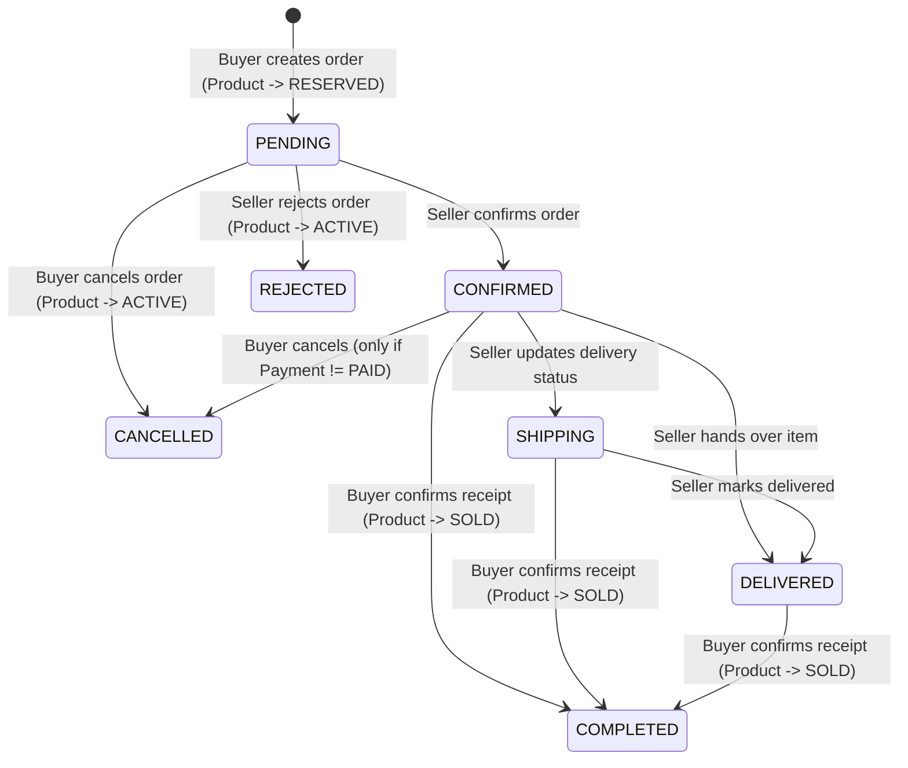

# ReMarket — Order & Product Reservation Workflow (`ORDER_WORKFLOW.md`)

## 1. Overview

ReMarket supports end-to-end second-hand marketplace transactions between a **Buyer** and a **Seller** for single-unit second-hand items (`quantity = 1`). Every order is linked to:
- A specific `Product` (`productId`) with an immutable `productSnapshot` captured at order creation time (`title`, `price`, `condition`, `imageUrl`, `location`).
- A `Buyer` (`buyerId`) and `Seller` (`sellerId`, derived strictly from `product.sellerId` on the backend, never trusted from client payload).
- A dedicated `Payment` record (`payments` collection).
- A buyer–seller `Conversation` (`conversationId`) with automatic `ORDER` event messages (`MessagesService.postOrderEventMessage`) and in-app `Notification` records (`notifications` collection).

---

## 2. Order Status Lifecycle & State Machine



### Valid Status Values (`OrderStatus`)
| Status | Actor | Description | Product Status Impact |
| :--- | :--- | :--- | :--- |
| `PENDING` | Buyer (`POST /orders`) | Initial order request created by buyer. | `ACTIVE` $\rightarrow$ `RESERVED` |
| `CONFIRMED` | Seller (`PATCH /orders/:id/confirm`) | Seller accepts the order and agrees to fulfill. | Remains `RESERVED` |
| `SHIPPING` | Seller (`PATCH /orders/:id/delivery`) | Item is in transit or seller is heading to meetup point. | Remains `RESERVED` |
| `DELIVERED` | Seller (`PATCH /orders/:id/delivery`) | Seller has handed over or delivered the item. | Remains `RESERVED` |
| `COMPLETED` | Buyer (`PATCH /orders/:id/complete`) | Buyer confirms item receipt; transaction finalized. | `RESERVED` $\rightarrow$ `SOLD` |
| `REJECTED` | Seller (`PATCH /orders/:id/reject`) | Seller declines the order request. | `RESERVED` $\rightarrow$ `ACTIVE` (if no other active order) |
| `CANCELLED` | Buyer (`PATCH /orders/:id/cancel`) | Buyer cancels before completion/payment lock. | `RESERVED` $\rightarrow$ `ACTIVE` (if no other active order) |

---

## 3. Product Reservation & Concurrency Control (Standalone MongoDB Safe)

Because local and containerized MongoDB deployments may run as standalone instances without replica-set multi-document transactions, ReMarket enforces concurrency safety using **two atomic MongoDB primitives**:

1. **Atomic Conditional Product Reservation (`findOneAndUpdate`)**:
   ```ts
   const reservedProduct = await this.productModel.findOneAndUpdate(
     {
       _id: productObjId,
       status: ProductStatus.ACTIVE,
       sellerId: { $ne: buyerObjId },
     },
     { $set: { status: ProductStatus.RESERVED } },
     { new: true },
   );
   ```
   - If two buyers submit `POST /api/v1/orders` for the same `ACTIVE` product simultaneously, MongoDB's document-level write lock guarantees that **only one** `findOneAndUpdate` matches `status: ACTIVE` and transitions the product to `RESERVED`. The second request receives `null` and immediately throws `409 Conflict`.

2. **Partial Unique Index on Active Orders (`unique_active_order_per_product_idx`)**:
   ```ts
   OrderSchema.index(
     { productId: 1 },
     {
       unique: true,
       partialFilterExpression: {
         status: { $in: ['PENDING', 'CONFIRMED', 'SHIPPING', 'DELIVERED'] },
       },
       name: 'unique_active_order_per_product_idx',
     },
   );
   ```
   - Guarantees at the storage engine level that a product can never have more than one active holding order (`PENDING`, `CONFIRMED`, `SHIPPING`, `DELIVERED`).
   - If `orderModel.create()` fails for any reason after the product was flipped to `RESERVED`, `OrdersService.restoreProductAvailabilityIfNoActiveOrders()` atomically checks `countDocuments` for any active order on that product and restores `status: ACTIVE` only when `activeCount === 0`.

---

## 4. Delivery & Payment Method Compatibility Rules

| Delivery Method (`DeliveryMethod`) | Allowed Payment Methods (`PaymentMethod`) | Required Fields |
| :--- | :--- | :--- |
| `MEETUP` (Giao dịch trực tiếp) | `CASH`, `BANK_TRANSFER` | Optional `meetupLocation` |
| `DELIVERY` (Giao hàng tận nơi) | `COD`, `BANK_TRANSFER` | Mandatory `shippingAddress` ($\ge 5$ chars) |
