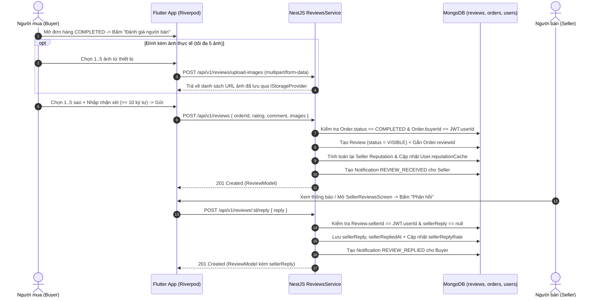

# ReMarket — Review & Post-Transaction Verification Workflow (`REVIEW_WORKFLOW.md`)

Tài liệu mô tả kiến trúc, quy tắc xác thực giao dịch thật (Anti-Fake-Review), luồng chỉnh sửa/phản hồi và kiểm duyệt đánh giá trong dự án **ReMarket** (`Phase 9.6`).

---

## 1. Nguyên tắc cốt lõi (Verified Transaction Reviews)

Hệ thống đánh giá của ReMarket được thiết kế để đảm bảo **100% review có nguồn gốc từ giao dịch thực tế đã hoàn tất**:

1. **Bắt buộc gắn với Order `COMPLETED`**:
   - Chỉ khi đơn hàng đạt trạng thái `OrderStatus.COMPLETED` (tương ứng `ProductStatus.SOLD`), người mua mới được phép gửi đánh giá.
   - Mọi yêu cầu đánh giá cho đơn `PENDING`, `CONFIRMED`, `SHIPPING`, `DELIVERED`, `CANCELLED` hoặc `REJECTED` đều bị từ chối với `400 Bad Request`.
2. **Xác thực danh tính từ JWT (`@CurrentUser()`)**:
   - Backend tuyệt đối không nhận `buyerId` hoặc `sellerId` từ body của client.
   - `buyerId` được trích xuất trực tiếp từ JWT Access Token và đối chiếu `String(order.buyerId) === requesterUserId`. Nếu không khớp, trả về `403 Forbidden`.
   - `sellerId` và `productId` được suy xuất trực tiếp từ bản ghi `Order` trong MongoDB.
3. **Chống tự đánh giá (No Self-Review)**:
   - Kiểm tra hai lớp (khi tạo đơn và khi tạo đánh giá): `buyerId !== sellerId`.
4. **Mỗi đơn hàng tối đa 01 đánh giá duy nhất**:
   - Đảm bảo ở cả tầng ứng dụng (`ConflictException 409`) lẫn tầng cơ sở dữ liệu thông qua unique index `unique_review_per_order_idx` trên trường `orderId` của collection `reviews`.

---

## 2. Sơ đồ luồng đánh giá & phản hồi

---

## 3. Chính sách chỉnh sửa, xóa và kiểm duyệt (Anti-Abuse & Moderation)

| Thao tác | Quy tắc áp dụng | Mã phản hồi khi vi phạm |
| :--- | :--- | :--- |
| **Chỉnh sửa đánh giá (`PATCH /api/v1/reviews/:id`)** | Chỉ **Buyer** tạo đánh giá mới được sửa trong vòng **07 ngày** kể từ `createdAt`. Sau khi sửa `rating`, hệ thống lập tức tính lại `reputationScore`. | `403 Forbidden` (sai chủ sở hữu) hoặc `400 Bad Request` (quá 7 ngày) |
| **Xóa tùy ý (`DELETE /api/v1/reviews/:id`)** | **Cấm xóa tùy ý** từ phía người dùng nhằm bảo vệ tính toàn vẹn của lịch sử uy tín. | `403 Forbidden` |
| **Phản hồi của người bán (`POST /api/v1/reviews/:id/reply`)** | Chỉ **Seller** của đơn hàng đó được phản hồi **01 lần duy nhất**. Seller không thể sửa `rating` hoặc `comment` của Buyer. | `403 Forbidden` (không phải seller) hoặc `409 Conflict` (đã phản hồi) |
| **Chặn nội dung vi phạm / PII** | Bộ lọc nội dung kiểm tra độ dài tối thiểu (`>= 10` ký tự), chặn spam ký tự lặp và chặn rò rỉ thông tin nhạy cảm (Mật khẩu, mã OTP, CVV). | `400 Bad Request` |
| **Báo cáo & Ẩn đánh giá (`POST /api/v1/reviews/:id/report`)** | Người dùng có thể báo cáo đánh giá vi phạm tiêu chuẩn cộng đồng. Hệ thống **không tự động ẩn đánh giá chỉ vì số sao thấp (1-2 sao)**. Khi kiểm duyệt viên chuyển `status` sang `HIDDEN` hoặc `DELETED`, đánh giá đó được loại khỏi phép tính `averageRating` & `reputationScore` ngay lập tức. | `409 Conflict` nếu cùng 1 người báo cáo lặp lại |
