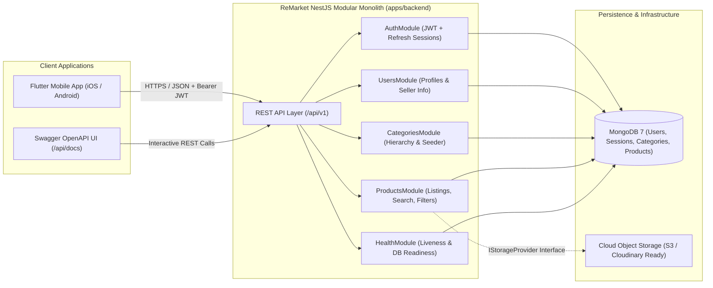

# ReMarket — System Overview

## 1. Product Vision & Scope

**ReMarket** is a mobile-first second-hand marketplace application designed for students and urban consumers to buy and sell pre-owned electronics, computer accessories, phones, textbooks, furniture, and everyday items with transparency and trust.

### Core User Workflows
1. **Browse & Discover**: Explore curated active product listings across structured categories on the Home Feed.
2. **Search, Filter & Sort**: Search products by title and description keywords, filter by category, condition (`NEW`, `LIKE_NEW`, `GOOD`, `FAIR`), price range (`minPrice`–`maxPrice`), and location, and sort by `newest`, `price_asc`, or `price_desc`.
3. **Inspect Product & Seller Details**: View high-resolution product galleries, condition metadata, view counts, and verified public seller profiles.
4. **Create & Manage Listings**: Authenticated sellers can create, update, archive, mark as sold, or delete their own listings and inspect their inventory via `/api/v1/products/my-listings`.
5. **Future Phases**:
   - **Phase 2**: Favorites / Watchlist, Buyer-Seller Messaging, and Listing Reports.
   - **Phase 3**: AI Service integration (AI Price Estimator, AI Buyer Inspection Checklist, AI Listing Draft Assistant).
   - **Phase 4**: Mobile Client (Flutter) full end-to-end integration and cloud media uploads.

---

## 2. High-Level System Architecture

ReMarket Phase 1 uses a **Modular Monolith** architecture built with **NestJS**, **TypeScript**, and **MongoDB (Mongoose)**. This architecture provides strict domain boundaries and low operational overhead while keeping modules cleanly decoupled for future extraction (such as a dedicated AI microservice).

---

## 3. Technology Stack

| Layer | Technology | Purpose |
| :--- | :--- | :--- |
| **Runtime** | Node.js (v20+ / v22+) | Asynchronous JavaScript/TypeScript server runtime |
| **Framework** | NestJS 10 | Modular dependency-injected backend framework |
| **Language** | TypeScript 5 | Strict static typing across DTOs, services, and schemas |
| **Database** | MongoDB 7 + Mongoose 8 | Document database with compound & text search indexes |
| **Authentication** | Passport JWT + `bcrypt` | Short-lived access tokens + rotated hashed refresh tokens |
| **Validation** | `class-validator` + `class-transformer` | Whitelisted, declarative request payload & query validation |
| **API Docs** | `@nestjs/swagger` (OpenAPI 3.0) | Interactive API documentation served at `/api/docs` |
| **Testing** | Jest + Supertest | Unit tests (`*.spec.ts`) and end-to-end HTTP tests (`*.e2e-spec.ts`) |
| **Containers** | Docker + Docker Compose | Reproducible local and CI multi-container orchestration |
