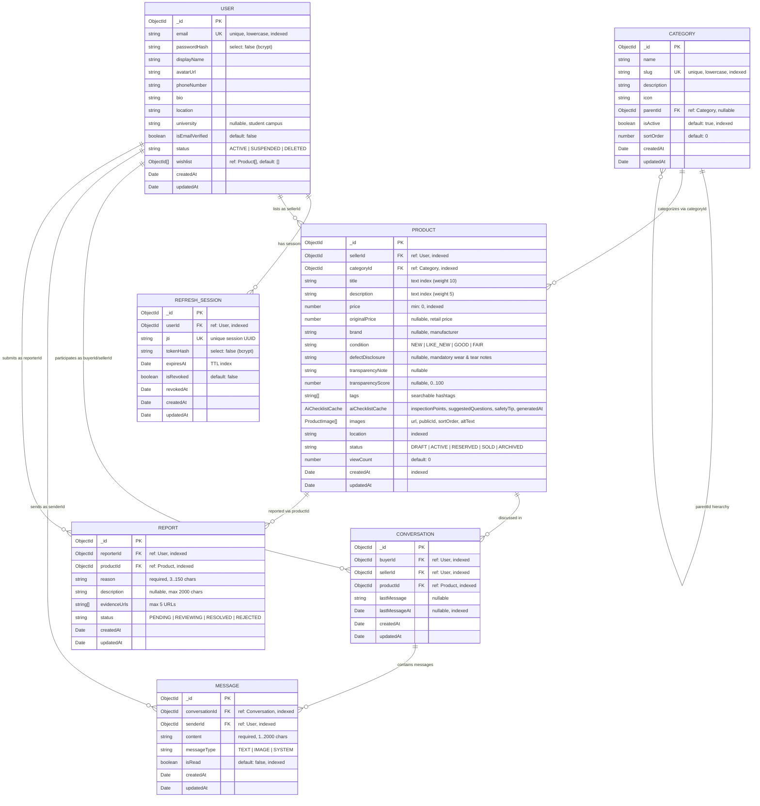

# ReMarket — Database Data Model

## 1. Overview

ReMarket uses **MongoDB** with **Mongoose** schemas. All collections enable `timestamps: true` (`createdAt`, `updatedAt`) and configure `toJSON` transforms that expose `id` alongside `_id` while stripping internal fields (`__v`, `passwordHash`, `tokenHash`).

---

## 2. Collection Specifications & Indexes

### 2.1 `users` Collection (`User`)
- **Purpose**: Stores buyer and seller accounts, profile metadata, and wishlisted product references (`wishlist: ObjectId[]`).
- **Security**: `passwordHash` has `select: false` at the schema level and is explicitly deleted in `toJSON`/`toObject` transforms and `UsersService.sanitizeUser()`.
- **Indexes**:
  - `{ email: 1 }` (Unique)
  - `{ status: 1 }`

### 2.2 `refreshsessions` Collection (`RefreshSession`)
- **Purpose**: Tracks active and revoked refresh tokens for secure session rotation and logout.
- **Indexes**:
  - `{ jti: 1 }` (Unique)
  - `{ userId: 1, isRevoked: 1 }` (Compound session lookup & revocation index)
  - `{ expiresAt: 1 }` (TTL index `expires: 0`)

### 2.3 `categories` Collection (`Category`)
- **Purpose**: Organizes marketplace listings into top-level and child categories (`parentId`).
- **Indexes**:
  - `{ slug: 1 }` (Unique)
  - `{ parentId: 1 }`
  - `{ isActive: 1, sortOrder: 1, name: 1 }` (Compound index optimizing active category listing and sorting)

### 2.4 `products` Collection (`Product` & Embedded `ProductImage`)
- **Purpose**: Stores second-hand product listings created by sellers.
- **Enums**:
  - `ProductCondition`: `NEW`, `LIKE_NEW`, `GOOD`, `FAIR`
  - `ProductStatus`: `DRAFT`, `ACTIVE`, `SOLD`, `ARCHIVED`
- **Indexes**:
  - `{ categoryId: 1 }`, `{ price: 1 }`, `{ condition: 1 }`, `{ location: 1 }`, `{ createdAt: -1 }`
  - `{ sellerId: 1, status: 1, createdAt: -1 }` (Compound index for seller inventory `/products/me/listings`)
  - `{ status: 1, categoryId: 1, price: 1, createdAt: -1 }` (Compound marketplace browse & filter index)
  - `{ title: 'text', description: 'text' }` (`product_text_search_idx`, weights `{ title: 10, description: 5 }`)

### 2.5 `conversations` Collection (`Conversation`)
- **Purpose**: Tracks buyer-seller chat threads anchored to a specific product listing.
- **Indexes**:
  - `{ buyerId: 1, sellerId: 1, productId: 1 }` (**Unique** compound index `unique_buyer_seller_product_conversation_idx` — prevents duplicate conversations for the same buyer/seller/product)
  - `{ buyerId: 1, lastMessageAt: -1, updatedAt: -1 }`
  - `{ sellerId: 1, lastMessageAt: -1, updatedAt: -1 }`
  - `{ productId: 1 }`, `{ lastMessageAt: 1 }`

### 2.6 `messages` Collection (`Message`)
- **Purpose**: Stores individual messages within a `Conversation`.
- **Enum**: `MessageType` (`TEXT`, `IMAGE`, `SYSTEM`)
- **Indexes**:
  - `{ conversationId: 1, createdAt: 1 }` (Chronological message pagination)
  - `{ conversationId: 1, isRead: 1, senderId: 1 }` (Unread status lookups)
  - `{ senderId: 1 }`, `{ isRead: 1 }`

### 2.7 `reports` Collection (`Report`)
- **Purpose**: Stores user-submitted listing violation reports.
- **Enum**: `ReportStatus` (`PENDING`, `REVIEWING`, `RESOLVED`, `REJECTED`)
- **Indexes**:
  - `{ reporterId: 1, productId: 1 }` (**Unique** compound index `unique_reporter_product_report_idx` — prevents duplicate report spam on the same product)
  - `{ reporterId: 1, createdAt: -1 }`
  - `{ productId: 1 }`, `{ status: 1 }`

### 2.8 `orders` Collection (`Order`)
- **Purpose**: Tracks second-hand purchase orders, embedded `productSnapshot` (`title`, `price`, `condition`, `imageUrl`, `location`), delivery/payment methods, and status history `timeline`.
- **Enums**:
  - `DeliveryMethod`: `MEETUP`, `DELIVERY`
  - `PaymentMethod`: `CASH`, `COD`, `BANK_TRANSFER`
  - `PaymentStatus`: `UNPAID`, `BUYER_CONFIRMED`, `PAID`, `CANCELLED`
  - `OrderStatus`: `PENDING`, `CONFIRMED`, `SHIPPING`, `DELIVERED`, `COMPLETED`, `REJECTED`, `CANCELLED`
- **Indexes**:
  - `{ orderCode: 1 }` (Unique)
  - `{ productId: 1 }` with `partialFilterExpression: { status: { $in: ['PENDING', 'CONFIRMED', 'SHIPPING', 'DELIVERED'] } }` (**Unique** partial index `unique_active_order_per_product_idx` — prevents two active orders from holding the same product concurrently)
  - `{ buyerId: 1, status: 1, createdAt: -1 }`
  - `{ sellerId: 1, status: 1, createdAt: -1 }`

### 2.9 `payments` Collection (`Payment`)
- **Purpose**: Dedicated payment record per order (`paymentId`, `orderId`, `payerId`, `receiverId`, `method`, `amount`, `status`, `transactionReference`, `transferNote`, `buyerConfirmationAt`, `sellerConfirmationAt`, `paidAt`). Never stores sensitive credentials (`bankPassword`, `OTP`, `CVV`, or full card details).
- **Indexes**:
  - `{ orderId: 1 }` (Unique)
  - `{ payerId: 1 }`, `{ receiverId: 1 }`, `{ status: 1 }`

### 2.10 `notifications` Collection (`Notification`)
- **Purpose**: Stores user-targeted order, payment, and review lifecycle notifications (`ORDER_CREATED`, `ORDER_CONFIRMED`, `ORDER_REJECTED`, `ORDER_CANCELLED`, `PAYMENT_BUYER_CONFIRMED`, `PAYMENT_CONFIRMED_BY_SELLER`, `ORDER_COMPLETED`, `REVIEW_RECEIVED`, `REVIEW_REPLIED`).
- **Indexes**:
  - `{ userId: 1, isRead: 1, createdAt: -1 }`

### 2.11 `reviews` Collection (`Review`) & Embedded `User.reputationCache`
- **Purpose**: Stores verified post-transaction buyer reviews (`orderId`, `buyerId`, `sellerId`, `productId`, `rating` `1..5`, `comment`, `images` max `5`, `sellerReply`, `sellerRepliedAt`, `status`, `reports`, `reportCount`, `moderationNote`).
- **Enum**: `ReviewStatus` (`VISIBLE`, `HIDDEN`, `DELETED`).
- **Indexes**:
  - `{ orderId: 1 }` (**Unique** index `unique_review_per_order_idx` — enforces at most one review per completed order at the MongoDB level)
  - `{ sellerId: 1, status: 1, rating: 1, createdAt: -1 }` (`seller_reviews_filter_sort_idx` — optimizes seller profile review pagination, star filtering, and rating distribution aggregation)
  - `{ buyerId: 1, createdAt: -1 }` (`buyer_reviews_history_idx`)
  - `{ productId: 1, status: 1 }` (`product_reviews_lookup_idx`)
- **Embedded Cache on `users` (`User.reputationCache`)**:
  - Fields: `averageRating` (`0..5`), `totalReviews`, `reputationScore` (`0..100`), `completedOrdersCount`, `updatedAt`.
  - Automatically recalculated whenever a review is created, edited within 7 days, or moderated (`VISIBLE` $\leftrightarrow$ `HIDDEN`/`DELETED`), enabling $O(1)$ reputation reads on Product Detail and Seller Profile endpoints.

